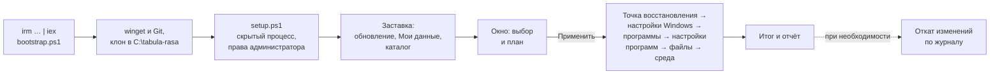

# Tabula Rasa

Развёртывание и обслуживание компьютеров с Windows из одного окна. Tabula Rasa подготавливает новый компьютер
с чистого листа или приводит в порядок существующий: отключает телеметрию, удаляет предустановленные приложения,
устанавливает программы и применяет настройки Windows. Весь каталог программ и настроек отображается в одном окне;
по завершении выводится итог, список действий, которые нужно выполнить вручную, и сохраняется отчёт. Обратимые изменения отменяются
командой `undo.ps1`.

Работает на Windows 10 и 11 без предварительной установки компонентов: достаточно встроенного Windows PowerShell 5.1.

Основные возможности:
- установка программ из каталога (winget или официальный сайт с проверкой цифровой подписи) и обновление установленных;
- настройки Windows: приватность, Проводник, панель задач, удаление предустановленных приложений, система;
- перенос настроек программ между компьютерами через собственный приватный репозиторий на GitHub («Мои данные»);
- собственные файлы (установщики, дистрибутивы) из релиза в том же репозитории;
- план перед применением, проверка «уже было» для каждого пункта, отчёт и откат изменений.

## Как это работает



Каждое изменение реестра, служб и задач записывается в журнал изменений до перехода к следующему, поэтому откат
возможен и после прерванного выполнения. Значения, которые уже совпадают с нужными, не изменяются и в журнал не попадают.

## Запуск

В PowerShell **от имени администратора**:
```powershell
irm iheeae.github.io/tabula-rasa | iex
```
Если на старых сборках Windows 10 соединение не устанавливается (TLS 1.2 не включён по умолчанию):
```powershell
[Net.ServicePointManager]::SecurityProtocol='Tls12'; irm iheeae.github.io/tabula-rasa | iex
```
Тот же загрузчик напрямую из репозитория:
```powershell
irm https://raw.githubusercontent.com/iheeae/tabula-rasa/master/bootstrap.ps1 | iex
```

Загрузчик (`bootstrap.ps1`) устанавливает winget и Git, клонирует репозиторий в `C:\tabula-rasa` и открывает окно.
Tabula Rasa работает как обычная программа, без окна консоли: ход запуска (проверка обновлений, перенос старых папок,
синхронизация «Моих данных», загрузка каталога) отображается на заставке, вопросы и ошибки — в окнах. В окне
PowerShell, из которого выполнена команда, остаётся строка «Tabula Rasa запущена, это окно можно закрыть».
Вход в GitHub не требуется. Если в `C:\tabula-rasa` находится посторонняя или устаревшая копия, она перемещается
в `C:\tabula-rasa.old_<дата>`; файлы не удаляются. Папка `C:\pc-base` от предыдущих версий переименовывается автоматически.

Повторный запуск на настроенном компьютере (с получением обновлений):
```powershell
powershell -ExecutionPolicy Bypass -File C:\tabula-rasa\setup.ps1
```
Параметры: `-Selection <имя или путь>` — открыть окно с сохранением, `-NoPull` — без `git pull`,
`-DataRoot <папка>` — расположение «Моих данных», если оно отличается от `C:\tabula-rasa-private`,
`-Console` — план и выполнение в консоли, как в предыдущих версиях (для отладки). Без него setup.ps1 запускает себя
заново скрытым процессом с правами администратора, и всё происходит в окне. Полный журнал выполнения в обоих случаях
записывается в `C:\ProgramData\tabula-rasa\logs\`. Если работа прервана ошибкой, открывается окно
«Что-то пошло не так» с путём к журналу.

Окно открывается в режиме **План**: кнопка «Показать план» показывает в окне все шаги по порядку, без изменений
в системе. Изменения применяются кнопкой «Применить…» после подтверждения.

## План, выполнение и итог

- **План** — шаги по этапам: точка восстановления, настройки Windows, программы, настройки программ, файлы, среда,
  имя компьютера. У шагов — пометки: «уже установлено: будет пропущено», «обновление», «необратимо», «сохранённых
  настроек нет», «откроется мастер установки».
- **Выполнение** — в том же окне: состояние каждого шага (ожидает, выполняется, готово, пропущено, ошибка), общий
  прогресс в окне и на кнопке на панели задач, журнал по кнопке «Показать журнал». «Пропустить текущий» прерывает
  текущую установку, «Остановить после текущего» завершает выполнение после текущего шага. Вопросы (например,
  выполнять ли необратимое без точки восстановления) задаются в окне. Пока идёт выполнение, окно не закрывается.
- **Итог** — что выполнено и что нет с причиной, «Повторить упавшее», список «Выполнить вручную» с отметками
  (сохраняются рядом с журналами), баннер «Нужна перезагрузка». Если окно свёрнуто, кнопка на панели задач мигает.
- Журналы: `logs\run_<дата>.log` — выполнение, `logs\changes_<дата>.json` — изменения для отката, `logs\winget_*.log` — вывод winget.

## Мои данные и сохранения

Репозиторий Tabula Rasa общий и не содержит личных данных. Личные сохранения, настройки программ и профиль
PowerShell хранятся в **«Моих данных»** — приватном репозитории `<логин>/tabula-rasa-private` на GitHub
с локальной копией в `C:\tabula-rasa-private`.

- **Подключение** — слева внизу окна. Вход в GitHub выполняется в браузере по одноразовому коду; если репозитория
  нет, он создаётся приватным, если есть (подключение со второго компьютера) — клонируется. Операция выполняется в фоне.
  Сохранения, созданные до подключения, можно перенести. Подключённый репозиторий отображается слева внизу,
  ссылка на него — в меню «⋯».
- **Разметка.** В корне репозитория — файл `tabula-rasa.json` с версией разметки. В новом репозитории Tabula Rasa
  создаёт README, папки `saves/` и `configs/`, пустой `catalog/apps.psd1`, `.gitignore` с защитой от случайной отправки
  ключей, баз паролей, файлов cookies и т. п. и фиксирует их одним коммитом «Разметка Tabula Rasa». В репозиторий
  с другими файлами без `tabula-rasa.json` после подтверждения добавляется только недостающее: существующие файлы
  не удаляются, не переносятся и не перезаписываются. Разметка, созданная более новой версией, открывается
  только для чтения. Другие файлы и папки репозитория программа не использует.
- **Видимость** проверяется при подключении и перед каждой отправкой. Если репозиторий стал публичным, изменения
  в GitHub не отправляются, а в окне отображается предупреждение: в настройках программ бывают личные данные.
- **Сохранения** (меню сверху) — именованные наборы отметок с датой и именем компьютера: открыть, сохранить текущий
  выбор (Ctrl+S), переименовать, удалить. Файл `.json` можно перетащить в окно. Сохранение содержит только отметки,
  без настроек программ. При подключённых «Моих данных» каждое изменение фиксируется коммитом и отправляется в GitHub;
  при отсутствии связи отправка выполняется при следующем запуске (в окне отображается «не отправлено: N»).
  Без подключения сохранения хранятся в `%LOCALAPPDATA%\tabula-rasa\saves`.
- **Отключить и удалить с этого компьютера** — меню «⋯» у «Моих данных»: удаляет `C:\tabula-rasa-private`,
  выполняет выход из GitHub CLI и удаляет токен git для github.com. Данные на GitHub не удаляются.
- Без подключения доступны все функции, кроме установки программ с сохранёнными настройками и раздела «Файлы».
  Формат данных — [configs/README.md](configs/README.md).

## Снятие настроек

Режим окна **«Снятие настроек»** (переключатель в шапке) сохраняет настройки программ этого компьютера
в «Мои данные»; при установке на другом компьютере они применяются вариантом «с моими настройками».
Выбор в режимах «Установка» и «Снятие настроек» независим.

- В списке — программы, чьи настройки найдены на этом компьютере. Для каждой указано, что снимается и что
  не снимается, где лежат настройки, а также дата последнего снятия и с какого компьютера.
- Снятие выполняется во временную папку. Перед записью строки и ключи, похожие на пароли, токены, cookies, сеансы
  и длинные base64-значения, удаляются, затем показывается, какие файлы будут добавлены или изменены. После
  подтверждения изменения фиксируются коммитом «Настройки: Vivaldi, VS Code (PC-01)» и отправляются в GitHub в фоне.
- Поддерживаются: Vivaldi, профиль PowerShell 7, Windows Terminal, VS Code (настройки, сочетания клавиш, список
  расширений — расширения устанавливаются при применении), Notepad++, Flow Launcher, Everything, PowerToys, Git
  (`.gitconfig` без разделов `[credential]`; вход в GitHub на целевом компьютере сохраняется), Wireshark (без `recent`),
  WinSCP (только параметры программы, без сохранённых сеансов), NanaZip, WinMerge, System Informer, draw.io,
  SumatraPDF, KeePassXC (без баз и путей к ним), ShareX (без токенов сервисов загрузки), Ditto (без истории буфера обмена).
  Списки недавних файлов и история не снимаются.
- Пути профиля пользователя (`C:\Users\<имя>\…`, раскрытые `%APPDATA%` и `%LOCALAPPDATA%`) при снятии заменяются
  переменными `%USERPROFILE%`, `%APPDATA%`, `%LOCALAPPDATA%`, а при применении раскрываются для текущего пользователя.
  Имя пользователя не попадает в репозиторий, а пути остаются верными на другом компьютере.
- Настройки из реестра (`HKCU\Software\<программа>`) сохраняются в JSON и применяются через `Set-Reg`:
  эти изменения записываются в журнал и отменяются командой `undo.ps1`.
- Без подключённых «Моих данных» вместо списка отображается карточка с кнопкой подключения.

## Собственный каталог программ

Кнопка **«Программа»** в шапке добавляет программу из winget в собственный каталог — `catalog/apps.psd1`
в «Моих данных». Программа появляется в окне на всех компьютерах с меткой **«мой каталог»** и удаляется из каталога
кнопкой в подробностях.

- Поиск — произвольным текстом на английском («notepad plus», «7zip», «obs»): winget ищет по названию,
  идентификатору и moniker, дополнительно выполняется поиск по тегам. Результаты объединяются без повторов:
  сначала точное совпадение названия, затем совпадение начала названия, затем остальные. Издатель и описание
  загружаются через `winget show`.
- Собственный каталог только декларативный: `Source = 'winget'` и поля описания (`Id`, `Name`, `Desc`, `Category`,
  `WingetId`, `Scope`, `Interactive`, `Note`, `Manual`, `OpenSource`, `License`). Источники `web`, ключи установщика,
  перенос настроек и код не допускаются. Записи с ошибками пропускаются с сообщением в окне.

## Файлы

Раздел «Файлы» содержит собственные файлы пользователя: установщики программ, которых нет в каталоге, дистрибутивы,
документы. Файлы хранятся как ассеты релиза `files` в репозитории «Моих данных» (`<логин>/tabula-rasa-private`) и
доступны только владельцу этого приватного репозитория.

- Без подключённых «Моих данных» вместо списка отображается карточка с кнопкой подключения. Список загружается в фоне.
- Отмеченные файлы загружаются в папку `Рабочий стол\tabula-rasa-files` и проверяются по контрольной сумме SHA-256,
  которую GitHub указывает для ассета (поле `digest`). Повреждённый файл удаляется. Файлы не устанавливаются и не запускаются.
- Имя ассета содержит только латинские буквы, цифры и символы `. _ -`, так как другие символы GitHub искажает.
  Исходное имя файла хранится в подписи ассета (`label`) и отображается в окне.
- **Добавление файлов** — на компьютере, где они хранятся (релиз `files` создаётся при первой загрузке, папка загружается
  архивом `.zip`, размер файла — меньше 2 ГБ):
  ```powershell
  powershell -ExecutionPolicy Bypass -File C:\tabula-rasa\tools\upload-files.ps1 <файл или папка> [...]
  ```
  Файл с тем же именем, который уже есть в релизе, пропускается; если он отличается, его заменяет ключ `-Replace`.
  Ключ `-DryRun` показывает, что будет загружено, без загрузки.
- **Перенос с Google Drive** (папка `pc-base-exe` прежних версий): ключ `-FromDrive` загружает в релиз всё содержимое
  папки `Мой диск\pc-base-exe` на подключённом Google Drive (другая папка — `-DriveDir <путь>`). Google Drive только
  читается: файлы на нём не удаляются и не изменяются.

## Окно выбора

Все программы и настройки, включая телеметрию (группа «Приватность»), выбираются отметками.
Тема и цвет акцента соответствуют настройкам Windows.

- **Три колонки.** Слева — разделы «Программы», «Настройки Windows», «Файлы» и их категории со счётчиком
  «выбрано/всего». В центре — карточки текущей категории, галочка **«Выбрать всё»** относится к ней.
  Справа — подробности: полное описание, источник (winget-ID или сайт), лицензия и действия после установки.
- **Статус на этом компьютере** проверяется в фоне при открытии окна: у программ — «установлено · версия»,
  «обновление: версия → версия», «не установлено» (сначала по реестру, затем по `winget list`); у настроек Windows —
  «применено», «применено частично», «не применено» (проверка без изменений в системе). Фильтры
  «Не установленные» и «Есть обновления», кнопка «Отметить обновления» — отмеченные программы обновляются через winget.
- **Метки в карточке:** **⚙** — доступна установка с сохранёнными настройками (заливка — выбрана, контур — доступна,
  серый — недоступна на этом компьютере); **Open source** — открытый исходный код; **мастер** — тихая установка
  невозможна; **необратимо**; **сайт** — загрузка с официального сайта с проверкой цифровой подписи.
- **Установка: «Чистая | С моими настройками»** — блок справа у программ с переносом настроек. Выбор варианта
  «с моими настройками» отмечает программу; снятие отметки возвращает чистую установку; «Выбрать всё» этот вариант не включает.
- **Поиск** — по всем разделам: название, описание, идентификатор, winget-ID, категория.
- **Итог** — внизу слева: все отмеченные пункты по разделам, отметки можно снимать на месте.
- **Уже было или изменено.** Перед записью значение сравнивается с текущим. Если нужное значение уже установлено,
  ничего не меняется и в журнал изменений не попадает. Итог настройки Windows: «уже было», «применено» или
  «изменено N из M». Итог программы: «уже установлено (версия)», «установлено (версия)», «обновлено (было → стало)».
  В плане сразу видно, сколько выбранных настроек уже применено.
- **Отчёт** — по окончании выполнения создаётся HTML-файл в «Документы\Tabula Rasa\Отчёты» (копия — в папке
  журналов): компьютер, версия Windows, шаги с результатом и раскрывающимся списком «было → стало», ошибки, раздел
  «Было настроено до прогона», действия вручную, журнал изменений для отката.
  Имя пользователя и пути профиля в отчёт не попадают. В PDF отчёт сохраняется печатью из браузера. На экране итога —
  кнопки «Перезагрузить», «Открыть отчёт», «Открыть папку» и «Закрыть».
- **Файлы** — собственные файлы из «Моих данных» (см. раздел «Файлы» выше); отмеченные загружаются
  в «Рабочий стол\tabula-rasa-files» без установки.
- **Имя компьютера** — пустое поле оставляет имя без изменений. В домене имя не меняется: переименование требует
  доменной учётной записи.
- Пункты с меткой **необратимо** (удаление UWP, OneDrive) не отменяются через `undo.ps1`, только точкой восстановления.
- Пункты, неприменимые к текущей версии Windows, не отображаются.
- Клавиши: **Ctrl+F** — поиск, **Esc** — очистить поиск, **Ctrl+S** — сохранить, **Ctrl+1 / 2 / 3** — разделы,
  **↑ / ↓** — категории, **Пробел** — отметить выбранную карточку, **F1** — список клавиш.
- Меню **«⋯»** в шапке: откат изменений, сведения о программе, клавиши.
- Тема, цвет акцента и высокая контрастность соответствуют Windows и меняются без перезапуска; в Windows 11 22H2
  и новее под окном — материал Mica. Размер, положение окна и последний раздел запоминаются
  (`%LOCALAPPDATA%\tabula-rasa\ui.json`).

## Порядок выполнения
1. Повышение прав (автоматически), обновление Tabula Rasa, синхронизация «Моих данных»
2. Точка восстановления
3. Настройки Windows
4. Программы (winget или официальный сайт с проверкой подписи). Установка каждой программы ограничена по времени:
   15 минут, с мастером установки — 60 (поле `TimeoutMin` в каталоге). Зависшая установка прерывается, в итоге
   отображается статус «ТАЙМАУТ», выполнение продолжается. Вывод winget — в `logs\winget_<дата>_<пакет>.log`
5. Сохранённые настройки программ, где выбран вариант «с моими настройками»
6. Отмеченные файлы из «Моих данных» → `Рабочий стол\tabula-rasa-files` со сверкой SHA-256
7. Среда: Windows Terminal, профиль PowerShell, `winget upgrade --all`
8. Имя компьютера, перезапуск Проводника
9. Итог, список действий вручную, отчёт, предложение перезагрузить компьютер

Журналы выполнения и журналы изменений — `C:\ProgramData\tabula-rasa\logs\`.

## Каталог

**Программы:** `catalog/apps.psd1`, одна строка — одна программа, правила в начале файла. В каталог включается
только программное обеспечение, бесплатное без ограничений (без лицензий, пробных периодов и активации);
исключения — Npcap и Docker Desktop, их условия указаны в поле `License`. Остальное размещается в разделе «Файлы». Источник — winget, а при отсутствии
или устаревании пакета — официальный сайт (`Source = 'web'`: актуальная версия со страницы загрузки, файл без
действительной подписи издателя не запускается).

<!-- catalog:begin (tools/catalog-doc.ps1) -->

<details><summary><b>Программы (31)</b></summary>

| Категория | Программа | Описание | Источник |
|---|---|---|---|
| Основа | Git | Система контроля версий. Используется Tabula Rasa для получения обновлений. *(открытый код; перенос настроек)* | winget `Git.Git` |
| Основа | GitHub CLI | Консольный клиент GitHub: вход в учётную запись, клонирование приватных репозиториев, работа с issues. *(открытый код)* | winget `GitHub.cli` |
| Основа | PowerShell 7 | Современная версия PowerShell. Устанавливается рядом с Windows PowerShell 5.1, работает быстрее и корректно использует UTF-8. *(открытый код; перенос настроек)* | winget `Microsoft.PowerShell` |
| Основа | Windows Terminal | Терминал с вкладками, панелями и выдвижной консолью по сочетанию клавиш. В Windows 11 установлен по умолчанию. *(открытый код; перенос настроек)* | winget `Microsoft.WindowsTerminal` |
| Повседневное | Vivaldi | Браузер с гибкой настройкой интерфейса. Устанавливается чистым или с сохранёнными настройками (значок ⚙, блок «Установка»). *(перенос настроек)* | winget `Vivaldi.Vivaldi` |
| Повседневное | Everything | Мгновенный поиск файлов по имени на всех дисках по индексу NTFS, показывает размеры папок. *(перенос настроек)* | winget `voidtools.Everything` |
| Повседневное | Flow Launcher | Панель запуска по Alt+Space: программы, поиск файлов через Everything, калькулятор, команды. Заменяет поиск в меню «Пуск». *(открытый код; перенос настроек)* | winget `Flow-Launcher.Flow-Launcher` |
| Повседневное | AIMP | Лёгкий аудиоплеер. | winget `AIMP.AIMP` |
| Игры | Radmin VPN | Виртуальная локальная сеть поверх интернета, в том числе для сетевых игр. | winget `Famatech.RadminVPN` |
| Игры | Steam | Клиент Steam: игры и Wallpaper Engine. | winget `Valve.Steam` |
| Сеть и ИБ | Wireshark | Анализатор сетевого трафика. Для захвата пакетов требуется Npcap (есть в этом же разделе). *(открытый код; перенос настроек)* | winget `WiresharkFoundation.Wireshark` |
| Сеть и ИБ | iperf3 | Измерение пропускной способности сети между двумя узлами. *(открытый код)* | winget `ar51an.iPerf3` |
| Сеть и ИБ | Npcap | Драйвер захвата пакетов для Wireshark и Nmap. В winget отсутствует, загружается с npcap.com с проверкой цифровой подписи. *(условия: Бесплатно до 5 систем; без ограничений при использовании с Nmap и Wireshark. Распространение запрещено лицензией.)* | официальный сайт |
| Сеть и ИБ | Nmap + Zenmap | Сканер сети и портов с графической оболочкой Zenmap. В winget только устаревшая версия 7.80, поэтому актуальная загружается с nmap.org с проверкой цифровой подписи. Установщик предлагает установить и Npcap. *(условия: Nmap Public Source License: исходный код опубликован, бесплатное использование разрешено.)* | официальный сайт |
| Сеть и ИБ | Advanced IP Scanner | Сканер локальной сети с подключением по RDP и Radmin в один клик. *(условия: Закрытый код (Famatech, разработчик Radmin).)* | winget `Famatech.AdvancedIPScanner` |
| Система | System Informer | Расширенный диспетчер задач (ранее Process Hacker): процессы, службы, сеть, диски. *(открытый код; перенос настроек)* | winget `WinsiderSS.SystemInformer` |
| Система | Sysinternals Suite | Утилиты Microsoft Sysinternals: Process Explorer, Autoruns, TCPView, PsExec и другие. | winget `Microsoft.Sysinternals.Suite` |
| Повседневное | Ditto | История буфера обмена с поиском. *(открытый код; перенос настроек)* | winget `Ditto.Ditto` |
| Повседневное | NanaZip | Архиватор на основе 7-Zip с поддержкой нового контекстного меню Windows 11. *(открытый код; перенос настроек)* | winget `M2Team.NanaZip` |
| Сеть и ИБ | WinSCP | Клиент SFTP, SCP и FTP. *(открытый код; перенос настроек)* | winget `WinSCP.WinSCP` |
| Разработка | Notepad++ | Лёгкий текстовый редактор с подсветкой синтаксиса. *(открытый код; перенос настроек)* | winget `Notepad++.Notepad++` |
| Разработка | Docker Desktop | Контейнеры в Windows на базе WSL2. Требуется настройка «WSL2» из раздела «Среда». *(условия: Бесплатно для личного использования, обучения и компаний до 250 сотрудников и 10 млн $ годовой выручки; в остальных случаях — подписка.)* | winget `Docker.DockerDesktop` |
| Разработка | VS Code | Редактор кода с расширениями. *(перенос настроек; условия: Сборка Microsoft распространяется по собственной лицензии; исходный код VS Code открыт (MIT).)* | winget `Microsoft.VisualStudioCode` |
| Повседневное | KeePassXC | Менеджер паролей с локальной зашифрованной базой. *(открытый код; перенос настроек)* | winget `KeePassXCTeam.KeePassXC` |
| Повседневное | ShareX | Снимки и запись экрана с редактором, распознаванием текста и загрузкой. *(открытый код; перенос настроек)* | winget `ShareX.ShareX` |
| Разработка | draw.io | Редактор схем и диаграмм, работает без интернета. *(открытый код; перенос настроек)* | winget `JGraph.Draw` |
| Повседневное | SumatraPDF | Быстрый просмотрщик PDF, EPUB и DjVu. *(открытый код; перенос настроек)* | winget `SumatraPDF.SumatraPDF` |
| Разработка | WinMerge | Сравнение и слияние файлов и папок. *(открытый код; перенос настроек)* | winget `WinMerge.WinMerge` |
| Сеть и ИБ | Angry IP Scanner | Быстрый сканер IP-адресов и портов. Требуется Java. *(открытый код)* | winget `angryziber.AngryIPScanner` |
| Повседневное | PowerToys | Набор утилит Microsoft: редактор hosts и PATH, распознавание текста с экрана, предпросмотр файлов, переназначение клавиш. *(открытый код; перенос настроек)* | winget `Microsoft.PowerToys` |
| Повседневное | Google Drive | Клиент Google Drive: файлы Диска доступны в Проводнике как отдельный диск и синхронизируются с облаком. | winget `Google.GoogleDrive` |

</details>

<details><summary><b>Настройки Windows (33)</b></summary>

| Группа | Настройка | Что делает | Windows | Отмена |
|---|---|---|---|---|
| Приватность | Телеметрия: минимальный уровень, служба DiagTrack отключена | Политика телеметрии устанавливается на минимум; отключаются службы DiagTrack и WAP Push, задачи оценки совместимости, CEIP и сбора отзывов. | 10, 11 | откат изменений |
| Приватность | Реклама, рекомендации и автоматическая установка предлагаемых приложений | Отключаются рекламный идентификатор, персонализированные предложения, советы в меню «Пуск», автоматическая установка рекламируемых приложений и экран завершения настройки Windows. | 10, 11 | откат изменений |
| Приватность | Журнал действий, сбор вводимого текста, онлайн-распознавание речи | Отключаются журнал действий (Timeline), сбор набранного и рукописного текста и онлайн-распознавание речи. | 10, 11 | откат изменений |
| Приватность | Поиск без Bing и интернета | Поиск в меню «Пуск» выполняется только по компьютеру: без Bing, веб-подсказок и рекомендуемого содержимого. | 10, 11 | откат изменений |
| Приватность | Отключить Copilot и Recall политиками | Групповые политики отключают Copilot и запрещают Recall (снимки экрана для ИИ). | 10, 11 | откат изменений |
| Проводник | Показывать расширения файлов | Проводник показывает расширения (.exe, .pdf и т. д.). Это затрудняет маскировку файлов вида «фото.jpg.exe». | 10, 11 | откат изменений |
| Проводник | Показывать скрытые файлы | Отображаются скрытые файлы и папки, например AppData. Защищённые системные файлы остаются скрытыми. | 10, 11 | откат изменений |
| Проводник | Проводник открывается на «Этот компьютер» | По Win+E Проводник открывает «Этот компьютер» с дисками вместо «Главной». | 10, 11 | откат изменений |
| Проводник | Не показывать недавние файлы и частые папки | Панель быстрого доступа не показывает недавние файлы и часто используемые папки, история не накапливается. | 10, 11 | откат изменений |
| Проводник | Классическое контекстное меню | Правый клик сразу открывает полное контекстное меню, как в Windows 10, без пункта «Показать дополнительные параметры». | 11 | откат изменений |
| Панель задач | Убрать поиск с панели задач | Скрывает поле или значок поиска на панели задач. Поиск по клавише Win сохраняется. | 10, 11 | откат изменений |
| Панель задач | Убрать кнопку «Представление задач» | Скрывает кнопку виртуальных рабочих столов. Рабочие столы доступны по Win+Tab. | 10, 11 | откат изменений |
| Панель задач | Удалить виджеты / отключить «Новости и интересы» | Windows 11: удаляется пакет «Мини-приложения» (виджеты, включая карточки на экране блокировки). Windows 10: отключаются «Новости и интересы». | 10, 11 | только точкой восстановления |
| Панель задач | Убрать значок «Чат» (Teams) | Скрывает на панели задач значок «Чат» (Teams для дома). | 11 | откат изменений |
| Панель задач | Windows 10: убрать Кортану, «Люди» и «Провести собрание» с панели задач | Скрывает на панели задач Windows 10 кнопки Кортаны, «Люди» и «Провести собрание». | 10 | откат изменений |
| Панель задач | Windows 10: убрать Windows Ink и сенсорную клавиатуру с панели задач | Скрывает на панели задач Windows 10 кнопки Windows Ink и сенсорной клавиатуры. | 10 | откат изменений |
| Панель задач | Windows 11: больше закреплённых приложений в меню «Пуск» | Макет меню «Пуск» «Больше закреплённых»: меньше места под рекомендации. | 11 | откат изменений |
| Панель задач | Кнопка «Пуск» слева | Кнопка «Пуск» и значки панели задач выравниваются по левому краю, как в Windows 10. | 11 | откат изменений |
| Мусор | Удалить предустановленные приложения (новости, погода, советы, Clipchamp, Solitaire…) | Удаляются предустановленные приложения: новости, погода, советы, Solitaire, Clipchamp, To Do, Skype, «Почта и календарь», «Кино и ТВ» и другие. Вернуть их можно только из Microsoft Store. | 10, 11 | только точкой восстановления |
| Мусор | Удалить приложение Copilot | Удаляет приложение Copilot. | 10, 11 | только точкой восстановления |
| Мусор | Удалить «Связь с телефоном» и Cross Device | Удаляются «Связь с телефоном» и Cross Device; политика запрещает связывать компьютер с телефоном. | 10, 11 | только точкой восстановления |
| Мусор | Удалить компоненты Xbox | Удаляются приложения Xbox и Game Bar, отключается запись игр. Не рекомендуется для игровых компьютеров с Game Pass. | 10, 11 | только точкой восстановления |
| Мусор | Удалить OneDrive | Удаляет OneDrive и скрывает его в Проводнике. Пропускается, если Рабочий стол или Документы перенесены в OneDrive. | 10, 11 | только точкой восстановления |
| Система | WSL2 и платформа виртуальных машин (для Docker) | Включает WSL и платформу виртуальных машин, устанавливает ядро WSL2 (требуется для Docker). Потребуется перезагрузка. | 10, 11 | откат изменений |
| Система | Отключить залипание клавиш по 5×Shift | Пятикратное нажатие Shift больше не открывает окно залипания клавиш (полезно в играх). | 10, 11 | откат изменений |
| Система | Отключить ускорение мыши | Отключается «Повышенная точность установки указателя»: курсор движется строго пропорционально мыши. | 10, 11 | откат изменений |
| Система | Тёмная тема | Тёмная тема для системы и приложений. | 10, 11 | откат изменений |
| Система | Схема электропитания «Высокая производительность» (кроме ноутбуков) | Включает схему электропитания «Высокая производительность». На ноутбуках пропускается. | 10, 11 | откат изменений |
| Система | Отключить гибернацию и быстрый запуск | Отключает гибернацию (файл hiberfil.sys занимает несколько гигабайт) и быстрый запуск. Спящий режим сохраняется. | 10, 11 | откат изменений |
| Среда | Windows Terminal: PowerShell 7 по умолчанию, Cascadia Code 11, выдвижная консоль Alt+` | Профиль по умолчанию — PowerShell 7, шрифт Cascadia Code 11, выдвижная консоль по Alt+` (Alt+Ё), запуск при входе в систему со сворачиванием в область уведомлений. *(выполняется после установки программ)* | 10, 11 | откат изменений |
| Среда | Windows Terminal как терминал по умолчанию | Консольные программы открываются в Windows Terminal вместо окна conhost. *(выполняется после установки программ)* | 11 | откат изменений |
| Среда | Профиль PowerShell 7: подсказки из истории, приглашение с веткой git, псевдонимы | Устанавливает профиль PowerShell 7 (из Моих данных или встроенный): подсказки из истории, меню по Tab, ветка git в приглашении, псевдонимы ll, which и touch. *(выполняется после установки программ)* | 10, 11 | откат изменений |
| Среда | Обновить все установленные программы (winget upgrade --all) | В конце прогона обновляет все программы, известные winget. На рабочем компьютере затрагивает и корпоративное ПО. *(выполняется после установки программ)* | 10, 11 | откат изменений |

</details>

<!-- catalog:end -->

**Настройки Windows:** `catalog/tweaks.ps1`. Реестр изменяется только через `Set-Reg`, службы — через `Set-SvcStart`,
задачи — через `Disable-Task`: так изменения попадают в журнал и могут быть отменены.

**Перенос настроек программ:** поле `Config` в `apps.psd1` (`File`, `From`, `Export`, `Import`, `Desc`, `Skip`,
описание — в начале файла) и функции снятия и применения в `lib/configs.ps1`; данные — в «Моих данных».

Таблицы каталога выше создаются из `catalog/` командой `tools\catalog-doc.ps1`; CI проверяет, что они актуальны.

## Как добавить программу или настройку

**Программа из winget** — строка в `catalog/apps.psd1` (идентификатор — из `winget search <название>`). Порядок строк
определяет порядок установки:
```powershell
@{ Id = 'obs'; Name = 'OBS Studio'; Category = 'Медиа'; Source = 'winget'; WingetId = 'OBSProject.OBSStudio'; OpenSource = $true
   Desc = 'Запись экрана и трансляции.' }
```
Для себя, без изменения общего каталога, программа добавляется кнопкой «Программа» в окне (собственный каталог
в «Моих данных»).

**Настройка Windows** — запись в `catalog/tweaks.ps1`. В `Apply` используются только `Set-Reg`, `Set-SvcStart`,
`Disable-Task` и `Remove-Appx`: тогда изменения попадают в журнал и отменяются, а состояние «уже применено»
проверяется автоматически. Для других команд нужна проверка `Check = { … }`, которая только читает состояние:
```powershell
@{ Id = 'exp.thispc'; Name = 'Проводник открывается на «Этот компьютер»'; Desc = 'По Win+E открывается «Этот компьютер».'
   Group = 'Проводник'; Os = @('10', '11'); Phase = 'pre'
   Apply = { Set-Reg 'HKCU:\Software\Microsoft\Windows\CurrentVersion\Explorer\Advanced' 'LaunchTo' 1 } }
```
После изменения каталога: `tools\catalog-doc.ps1` (таблицы в README) и проверки из раздела «Разработка».

**Набор отметок** — кнопка «Сохранения» в окне: текущий выбор сохраняется под именем и открывается на любом компьютере
с подключёнными «Моими данными» или командой `setup.ps1 -Selection <имя>`.

## Что делать, если…

- **Установка программы зависла.** Кнопка «Пропустить текущий» прерывает её, выполнение продолжается. Без вмешательства
  установка прерывается по ограничению времени (статус «ТАЙМАУТ»). Вывод winget — в `logs\winget_<дата>_<пакет>.log`.
- **Программа не устанавливается.** Причина указана в итоге и в отчёте. Чаще всего это нет связи с источником, пакет
  переименован в winget или установщику нужна перезагрузка. Кнопка «Повторить упавшее» повторяет только шаги с ошибкой.
- **Точка восстановления не создана.** Защита системы может быть отключена политикой или для диска. Перед необратимыми
  изменениями (удаление приложений) в этом случае задаётся вопрос; остальные изменения отменяются по журналу.
- **Выполнение прервано** (закрыт процесс, отключилось питание). Уже сделанные изменения записаны в журнал изменений;
  их можно отменить в окне («⋯ → Откат изменений») или запустить Tabula Rasa снова: выполненные пункты отобразятся как «уже было».
- **Нужно отменить изменения.** «⋯ → Откат изменений» или `undo.ps1`. Удалённые встроенные приложения и установленные
  программы так не возвращаются: для этого используется точка восстановления «tabula-rasa <дата>».
- **Окно не открылось.** Если работа прервана ошибкой, открывается окно «Что-то пошло не так» с путём к журналу.
  Для отладки — `setup.ps1 -Console`: всё выполняется в консоли. Журналы — `C:\ProgramData\tabula-rasa\logs\`.
- **В тексте вместо русских букв непонятные символы.** Файл `.ps1` сохранён без BOM: Windows PowerShell 5.1 читает
  его в другой кодировке. Файл нужно сохранить в UTF-8 с BOM (проверка — `tests\ci.ps1`).
- **«Мои данные» не отправляются.** При отсутствии связи изменения отправляются при следующем запуске («не отправлено: N»).
  Если репозиторий стал публичным, отправка не выполняется до возврата приватности.

## Вопросы и ответы

- **Нужен ли аккаунт GitHub?** Нет. Он нужен только для «Моих данных»: переноса настроек программ, сохранений и файлов
  между компьютерами.
- **Что будет, если запустить Tabula Rasa повторно?** Будет выполнен тот же план; уже применённые настройки и
  установленные программы отобразятся как «уже было» и не изменятся.
- **Можно ли только посмотреть, что изменится?** Да: окно открывается в режиме «План», изменения вносятся только
  после «Применить…» и подтверждения.
- **Работает ли в домене?** Да. Имя компьютера в домене не меняется; если права администратора получены другой
  учётной записью, перед применением настроек пользователя задаётся вопрос.
- **Куда сохраняется отчёт?** В «Документы\Tabula Rasa\Отчёты» и в папку журналов. В PDF он сохраняется печатью из браузера.
- **Почему в каталоге нет программы X?** В общий каталог входит только бесплатное без условий. Остальное добавляется
  в собственный каталог или в раздел «Файлы».

## Разработка

- `tests\ci.ps1` — проверки перед коммитом: синтаксис, каталог, тон текстов, кодировка, личные данные, таблицы
  каталога в README; на Windows также компиляция модели окна и загрузка разметки окон.
- `tests\run.ps1` — проверки логики без окна и без сети: разбор вывода winget, свой каталог, фильтр секретов, снятие
  настроек, разметка «Моих данных», план и выполнение, «уже было», отчёт.
- CI (`.github/workflows/ci.yml`) запускает оба скрипта на Windows в Windows PowerShell 5.1 и PowerShell 7, а также
  PSScriptAnalyzer. Раз в неделю проверяется, что все `WingetId` каталога есть в источнике winget (`tools\check-winget-ids.ps1`).
- Новую версию перед применением на рабочих компьютерах следует проверить на чистой виртуальной машине
  со снимком: выполнение, повторный запуск, откат.

## Конфиденциальность

Tabula Rasa не собирает статистику и не передаёт данные третьим лицам. Программа обращается только к источникам
программ (winget, официальные сайты программ с `Source = 'web'`, PowerShell Gallery — если winget нужно установить), к этому репозиторию для обновлений и к GitHub
от имени пользователя: вход, репозиторий «Моих данных» и его релиз `files`. Личные данные отправляются только
в репозиторий «Моих данных» самого пользователя и только пока он приватный.

Настройки программ из «Моих данных» (в том числе профиль PowerShell, который выполняется при каждом запуске
PowerShell 7) применяются без изменений. Доступ на запись в репозиторий «Моих данных» следует давать только себе.

## Отмена изменений
```powershell
powershell -ExecutionPolicy Bypass -File C:\tabula-rasa\undo.ps1
```
Отменяет изменения реестра, служб, задач и PATH по последнему журналу изменений, включая журналы, созданные
предыдущими версиями (pc-base). В окне то же самое — «⋯ → Откат изменений…»: список журналов с датой и числом
изменений, откат выбранного. Удалённые UWP и установленные программы не восстанавливаются: для этого используется
точка восстановления, создаваемая в начале выполнения.

## Структура
```
bootstrap.ps1          загрузчик, только ASCII (публикуется на GitHub Pages)
setup.ps1              главный скрипт: окно выбора, выполнение
undo.ps1               отмена изменений по журналу
catalog/apps.psd1      программы
catalog/tweaks.ps1     настройки Windows
configs/               встроенные настройки по умолчанию и формат «Моих данных»
tools/                 снятие настроек Vivaldi из консоли, загрузка файлов в раздел «Файлы» (upload-files.ps1),
                       таблицы каталога в README (catalog-doc.ps1), проверка WingetId (check-winget-ids.ps1)
tests/ci.ps1           проверки перед коммитом (их же запускает CI)
tests/run.ps1          проверки без окна и без сети
lib/common.ps1         реестр, службы, задачи с журналом; winget; установка с сайта; поиск настроек; переезд папок
lib/data.ps1           сохранения и «Мои данные»: git, вход в GitHub, отключение, разметка, проверка видимости
lib/catalog.ps1        собственный каталог программ и поиск в winget
lib/status.ps1         статус программ и настроек Windows на этом компьютере
lib/run.ps1            план, выполнение по шагам, откат по журналу
lib/report.ps1         отчёт о выполнении (HTML)
lib/splash.ps1         заставка при запуске, окно «Что-то пошло не так»
lib/files.ps1          раздел «Файлы»: список и загрузка ассетов релиза files, сверка SHA-256
lib/configs.ps1        снятие и применение настроек программ, фильтр секретов
lib/gui.ps1            окно выбора, снятие настроек, окно «Добавить программу» (WPF)
lib/ui/                разметка окон (*.xaml), стили (theme.xaml), модель для привязок (model.cs)
.github/workflows/     CI на Windows (ci.yml), публикация загрузчика на GitHub Pages (pages.yml)
```
Все файлы `.ps1`, `.psd1`, `.xaml` и `.cs`, кроме `bootstrap.ps1`, сохраняются в **UTF-8 с BOM**: без него
Windows PowerShell 5.1 неверно читает кириллицу.
